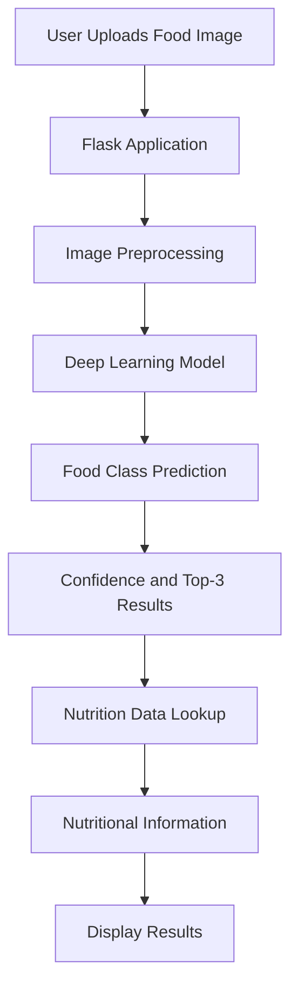
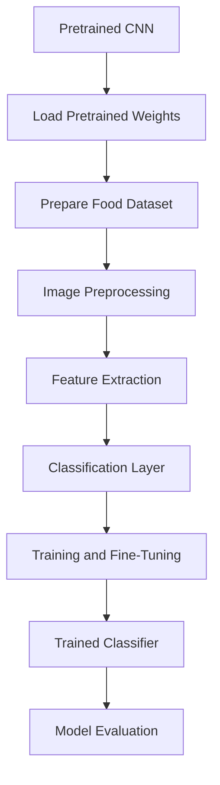

# 🍽️ FoodLens AI — Indian Food Recognition & Nutrition Estimator

**An AI-powered Indian food classification application built using Deep Learning, Computer Vision, and Transfer Learning.**

FoodLens AI allows users to upload an image of an Indian dish and receive its predicted food category, confidence score, alternative predictions, and estimated nutritional information.


---

## 📌 Project Overview

FoodLens AI is a deep learning-based web application that recognizes supported Indian food dishes from images and provides estimated nutritional information.

Users can upload a food image and receive:

- Predicted Indian food category
- Food name in English and Hindi
- Prediction confidence score
- Top-3 alternative predictions
- Estimated nutritional information
- Vegetarian or non-vegetarian classification
- Approximate calorie-burning walking-time estimate

The application combines image classification, transfer learning, image preprocessing, and nutrition data lookup in an interactive web interface.

## 🎯 Problem Statement

Indian cuisine includes a wide variety of dishes with different appearances, ingredients, and nutritional properties.

Identifying a dish from an image and understanding its nutritional value can be challenging.

FoodLens AI aims to simplify this process through an image-based food recognition system integrated with a nutrition information module.

## 💡 Proposed Solution

The application processes an uploaded food image using a trained deep learning model.

The predicted food category is then used to retrieve corresponding nutritional information from a predefined nutrition dataset.

The results are displayed through a Flask-powered web application.

---

## ✨ Key Features

| Feature | Description |
|---|---|
| Image Upload | Upload an image of an Indian food dish |
| Food Recognition | Predict the food category using Deep Learning |
| Bilingual Results | Display food names in English and Hindi |
| Confidence Score | Show the model's prediction confidence |
| Top-3 Predictions | Display alternative food predictions |
| Nutrition Estimation | Show calories, protein, carbohydrates, fat, and calcium |
| Food Classification | Display vegetarian or non-vegetarian category |
| Calorie Burn Estimate | Provide an approximate walking-time estimate |
| Interactive Interface | Web interface built using Flask, HTML, CSS, and JavaScript |
| Demo Mode | Demonstration experience when a trained model is unavailable |

> **Note:** Actual classification requires a compatible trained model and correct model configuration. Demo Mode results are illustrative and should not be treated as real model predictions.

---

## 🏗️ Application Architecture



### How It Works

1. **Image Upload:** The user uploads an image of an Indian dish.
2. **Preprocessing:** The image is resized and prepared for model input.
3. **Model Inference:** The deep learning model processes the image.
4. **Classification:** The model generates class probabilities.
5. **Nutrition Lookup:** The predicted food category retrieves corresponding nutritional information.
6. **Result Display:** The application displays predictions and estimated nutrition details.

---

## 🧠 Deep Learning Model

FoodLens AI is designed around transfer learning for multi-class image classification.

### Model Architecture

| Component | Configuration |
|---|---|
| Default Backbone | EfficientNetB0 |
| Alternative Backbone | MobileNetV2 |
| Framework | TensorFlow / Keras |
| Input Image Size | 224 × 224 |
| Task | Multi-class Image Classification |
| Output | Food Class Probabilities |

### EfficientNetB0

EfficientNetB0 is a convolutional neural network architecture that balances computational efficiency and model performance.

It uses compound scaling to coordinate network depth, width, and input resolution.

### MobileNetV2

MobileNetV2 is a lightweight CNN architecture designed for efficient image recognition.

It is useful for environments with limited computational resources.

### Transfer Learning Workflow



---

## 🍛 Supported Food Categories

The project is designed to recognize popular Indian dishes, including:

- Biryani
- Samosa
- Dosa
- Idli
- Gulab Jamun
- Pav Bhaji
- Chole Bhature
- Dhokla
- Other supported Indian food categories

The final supported classes depend on the labels included with the trained model.

---

## 🥗 Nutrition Information

After predicting a food category, the application retrieves nutritional information from its predefined nutrition data module.

| Attribute | Description |
|---|---|
| Calories | Estimated energy content |
| Protein | Estimated protein content |
| Carbohydrates | Estimated carbohydrate content |
| Fat | Estimated fat content |
| Calcium | Estimated calcium content |
| Food Type | Vegetarian / Non-Vegetarian |

**Disclaimer:** Nutritional values are estimates. Actual nutrition varies according to ingredients, preparation methods, recipes, and portion sizes.

---

## 🛠️ Technology Stack

| Technology | Purpose |
|---|---|
| Python | Core application logic |
| Flask | Web application framework |
| TensorFlow | Deep learning framework |
| Keras | Model development and inference |
| EfficientNetB0 | CNN architecture |
| MobileNetV2 | Lightweight CNN alternative |
| Pillow | Image processing |
| NumPy | Numerical computations |
| HTML | Frontend structure |
| CSS | Interface styling |
| JavaScript | Frontend interactions |

---

## 📁 Project Structure

```text
FoodLens-AI-Indian-Food-Classifier/
│
├── model/
│   └──                         # Model files and related assets
│
├── static/
│   ├── css/                    # Stylesheets
│   ├── js/                     # JavaScript files
│   └── images/                 # Static images
│
├── templates/
│   └── index.html              # Main web interface
│
├── app.py                      # Main Flask application
├── model.py                    # Model-related logic
├── model_transfer.py            # Transfer learning implementation
├── nutrition_data.py            # Nutrition information module
├── train.py                     # Model training script
├── train_on_colab.ipynb         # Google Colab training notebook
├── requirements.txt             # Project dependencies
├── .gitignore
├── LICENSE
└── README.md
```

---

## ⚙️ Installation and Setup

Follow these steps to run the project locally.

### 1. Clone the Repository

```bash
git clone https://github.com/prajapatishubham336/FoodLens-AI-Indian-Food-Classifier.git

cd FoodLens-AI-Indian-Food-Classifier
```

### 2. Create a Virtual Environment

**Windows PowerShell:**

```powershell
python -m venv venv

.\venv\Scripts\Activate.ps1
```

**Linux / macOS:**

```bash
python -m venv venv

source venv/bin/activate
```

### 3. Install Dependencies

```bash
python -m pip install --upgrade pip

pip install -r requirements.txt
```

### 4. Run the Application

```bash
python app.py
```

### 5. Open in Browser

Visit:

```text
http://127.0.0.1:5000
```

Upload an image of an Indian dish to explore the food classification results.

---

## 📦 Dependencies

The documented core dependencies include:

```text
Flask==3.0.3
Pillow==10.4.0
numpy==1.26.4
tensorflow==2.16.1
```

Install all project dependencies using:

```bash
pip install -r requirements.txt
```

---

## 🧪 Model Training

FoodLens includes a training script and a Google Colab notebook for model development.

### Training Script

```bash
python train.py
```

### Google Colab

Open `train_on_colab.ipynb` to work with model training in Google Colab.

Typical training workflow:

1. Dataset preparation
2. Image resizing and preprocessing
3. Training and validation split
4. Loading a pretrained CNN backbone
5. Feature extraction
6. Classification layer configuration
7. Model training and fine-tuning
8. Model evaluation
9. Saving the trained model and class labels

Actual dataset details, training parameters, and evaluation metrics should be documented after verification from the training code and notebook.

---

## ⚠️ Current Limitations

- Actual predictions require a compatible trained model.
- Demo Mode results are illustrative.
- Classification is limited to supported model categories.
- Nutrition values come from predefined data.
- Prediction confidence does not guarantee correctness.
- Model compatibility may depend on TensorFlow and Keras versions.
- Calorie-burn estimates are approximate and not personalized.
- Accuracy, precision, recall, and F1-score should be reported after proper evaluation.

---

## 🚀 Future Improvements

- Expand the Indian food image dataset.
- Improve classification performance using data augmentation and fine-tuning.
- Add accuracy, precision, recall, and F1-score evaluation.
- Add a confusion matrix.
- Improve model versioning and compatibility.
- Introduce food portion-size estimation.
- Provide more detailed nutritional information.
- Develop a REST API using FastAPI.
- Add Docker-based deployment.
- Deploy the application to a cloud platform.
- Implement automated testing and model monitoring.

---

## 🧠 AI/ML Concepts Demonstrated

- Computer Vision
- Image Classification
- Convolutional Neural Networks (CNNs)
- Transfer Learning
- EfficientNetB0
- MobileNetV2
- Image Preprocessing
- TensorFlow and Keras
- Model Inference
- Confidence Scores and Class Probabilities
- Flask Application Development
- ML Model Integration

---

## 🎤 Interview Talking Points

**1. What problem does FoodLens solve?**

It identifies supported Indian food dishes from images and provides estimated nutritional information.

**2. Why use EfficientNetB0?**

EfficientNetB0 balances computational efficiency and image classification performance using compound scaling.

**3. What is transfer learning?**

Transfer learning adapts a pretrained model to a new task, reducing the need to train an entire neural network from scratch.

**4. Why use Flask?**

Flask provides a lightweight Python web framework for integrating a trained deep learning model into a web application.

**5. What is image preprocessing?**

It prepares uploaded images in the correct size and numerical format expected by the model.

**6. What is a confidence score?**

It represents the model's predicted score or probability for a class and is not a guarantee of correctness.

**7. How would you improve this project?**

I would improve dataset quality, use data augmentation, evaluate the model with appropriate metrics, optimize inference, and deploy the application.

---

## 👨‍💻 Author

**Shubham Prajapati**

B.Sc. Data Science Student | Aspiring AI/ML Engineer

- **GitHub:** [@prajapatishubham336](https://github.com/prajapatishubham336)
- **Project Repository:** [FoodLens AI](https://github.com/prajapatishubham336/FoodLens-AI-Indian-Food-Classifier)

---

## ⭐ Support

If you find this project useful, consider giving the repository a star ⭐.

Contributions, suggestions, and feedback are welcome.

---

**Disclaimer:** FoodLens AI is an educational and experimental project. Food predictions and nutritional estimates should not be considered professional dietary or medical advice.